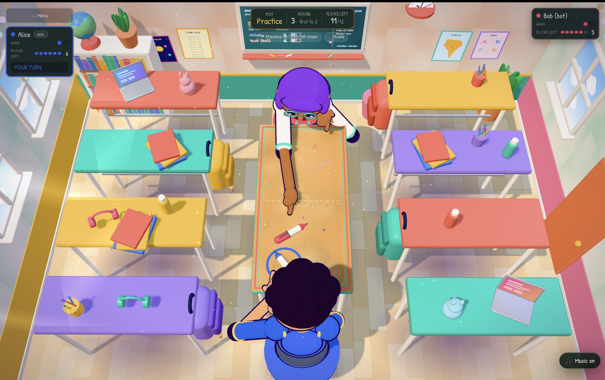

<p align="center">
  
</p>

<p align="center">
  <b>The last-bench classroom pen fight, on-chain.</b><br/>
  <a href="https://penfight.whyparabola.online/"><b>▶ Play it live</b></a> ·
  <a href="https://explorer.solana.com/address/FYd5yQ5ntHDUsmjrSbkm3EaxnzNpadtfjYHTQSnaNPM?cluster=devnet">Program on Solana devnet</a> ·
  <a href="#why-its-a-magicblock-game-and-not-just-a-solana-game">How it uses MagicBlock</a>
</p>



The classic last-bench classroom pen fight, played by **2, 3 or 4 players for a SOL pot**
(everyone stakes into the pot, the winner takes it all), plus an instant **practice mode vs
bots**. Built on **MagicBlock Ephemeral Rollups** for the Solana Blitz hackathon.

3D students sit around a desk in a bright classroom. You aim and flick your pen (drag back,
release); knock the other pens off the desk edge, last pen on the desk wins the round. First
to the target wins the match and the whole pot.

* **2 players:** classic duel (seats at the two short ends).
* **3-4 players:** free-for-all; seats on the long sides too. Turns skip pens that fell off.
  No free play: every player's stake goes into the pot.
* **vs Bot:** 1-3 bots (easy/medium/hard), no wallet, no stake, nothing on-chain, same physics.

## Deployed on Solana devnet

| | |
|---|---|
| **Program ID** | [`FYd5yQ5ntHDUsmjrSbkm3EaxnzNpadtfjYHTQSnaNPM`](https://explorer.solana.com/address/FYd5yQ5ntHDUsmjrSbkm3EaxnzNpadtfjYHTQSnaNPM?cluster=devnet) |
| **Cluster** | Solana **devnet** (no real funds) |
| **Ephemeral Rollup** | MagicBlock devnet US, `https://devnet-us.magicblock.app` (validator `MUS3hc9TCw4cGC12vHNoYcCGzJG1txjgQLZWVoeNHNd`) |
| **VRF queue** | `5hBR571xnXppuCPveTrctfTU7tJLSN94nq7kv7FRK5Tc` |
| **Framework** | Anchor 1.0.2, `ephemeral-rollups-sdk` 0.16.2, `session-keys` 3.1 |

The web app points at this program by default. The program id is also set in `web/lib/game.ts`.

## Why it's a MagicBlock game (and not just a Solana game)

| MagicBlock feature | How Pen Fight uses it |
|---|---|
| **Ephemeral Rollup** (delegate → commit → undelegate) | The match account is delegated to the ER the moment player 2 joins. Every flick is a transaction on the rollup — instant, gasless, no wallet pop-ups. When the match ends the final state is committed and undelegated back to Solana, then the pot is paid out on the base layer. |
| **VRF** (verifiable randomness) | Every round asks the VRF oracle for a seed. It decides **who flicks first** and the **starting pen offsets**, so neither player can bias a round. |
| **Session keys** | Creating/joining a match is the *only* wallet signature. It also registers a short-lived session key, which then signs every flick, VRF request and settlement call locally. |
| **Game logic on the rollup** | The physics are an integer-only deterministic simulation that runs *inside the Solana program* on the ER (`sim.rs`), now for up to 4 pens. The chain decides every collision, elimination and round result, so there is nothing for a client to cheat or dispute. |

### Provably fair physics

`anchor/programs/pen-fight/src/sim.rs` (Rust, on-chain) and `web/lib/sim.ts` (TypeScript,
browser) are bit-identical ports of one fixed-point simulation (no floats, `i64`
intermediates, lookup-table trig). The browser runs the same sim from the pre-flick state
to *animate* what the chain computed (and the bots use it to pick their flicks).
`web/scripts/e2e.ts` asserts that the TS result equals the on-chain account after **every**
flick for 2, 3 and 4 players, and `web/scripts/check-sim.ts` checks both implementations
against shared test vectors (`anchor/tests/vectors.json`, 2-4 pens, multi-flick sequences).

## How a match flows

```
 Solana base layer                          Ephemeral Rollup (MagicBlock)
 ─────────────────                          ─────────────────────────────
 P1: create_game  (stake → vault PDA)
     + session key created           (1 wallet signature)
 P2: join_game    (stake → vault PDA)
     + session key created
     + delegate_game ───────────────────►   Game PDA now lives on the ER
                                            request_seed ──► VRF oracle ──► callback_seed
                                            play_flick × N   (session-key signed, ~sub-second)
                                            … rounds … first to N wins
                                            finish_game: commit + undelegate ──┐
 claim_pot: vault pays the winner  ◄───────────────────────────────────────────┘
 (draw / abort → each stake refunded)
```

Safety nets, all on-chain:

* **Turn timer** – if the player on turn stalls for 45 s anyone can `claim_timeout`
  (a session key is enough; the outcome depends only on state). In a 2-player match the staller
  forfeits the match; in a 3-4 player match their pen is removed for the round and play goes on.
* **VRF timeout** – if the oracle never answers within 40 s the match aborts as a draw and both
  stakes are refunded.
* **Lobbies** – a 3-4 player lobby starts when the last seat fills (that player delegates in
  the same transaction). Until then a joiner can `leave_game` for a refund and the creator can
  `cancel_game`, which refunds everyone who joined.
* The pot lives in a **non-delegated vault PDA** on the base layer for the whole match, so
  funds never depend on the rollup staying alive during play.

## Repo layout

```
anchor/                    Anchor 1.0 program + tests + local-cluster scripts
  programs/pen-fight/src/
    lib.rs                 instructions, accounts, state machine, escrow/pot
    sim.rs                 deterministic integer physics (mirrored in web/lib/sim.ts)
    trig.rs                generated cos/sin table (0.5° steps)
  tests/vectors.json       shared physics test vectors (generated by the Rust sim)
  scripts/start-local.sh   boots base validator + ER + VRF oracles with the program loaded
  scripts/deploy-devnet.sh one-command devnet deploy
web/                       Next.js 16 app (deploys straight to Vercel)
  lib/client.ts            GameClient: all on-chain calls (wallet-signed + session-signed)
  lib/useMatch.ts          on-chain match state machine + "autopilot" (seed, finish, claim, timeouts)
  lib/localMatch.ts        off-chain practice match + bot AI (mirrors the program rules)
  lib/useLocalMatch.ts     the same Match interface for practice matches
  lib/sim.ts               TS port of the on-chain physics (2-4 pens)
  lib/seats.ts             seat names/colours shared by HUD and scene
  components/scene/        the 3D classroom, desk, pens and student characters (three.js)
  components/Lobby.tsx     create / join / open matches
  components/GameScreen.tsx HUD, results, on-chain activity log
  scripts/e2e.ts           headless N-player (2-4) end-to-end test against a cluster
  scripts/check-sim.ts     checks the TS physics against the Rust test vectors
```

## Run it locally (no devnet SOL needed)

Requirements: Rust + Solana CLI, **Anchor 1.0.2** (`avm install 1.0.2`), Node 20+, pnpm,
and the MagicBlock local validator tools: `npm i -g @magicblock-labs/ephemeral-validator`.

```bash
# 1. build the program (use Anchor 1.0.2 explicitly; your global anchor may differ)
cd anchor && ~/.avm/bin/anchor-1.0.2 build

# 2. start base validator + Ephemeral Rollup + VRF oracles (leave running)
./scripts/start-local.sh

# 3. in another terminal: headless e2e through the real client with N players
#    (lobby fill, leave/cancel refunds, full match, pot payout; --timeout adds the stall paths)
cd ../web && pnpm install
npx tsx scripts/check-sim.ts                                   # TS physics == Rust physics
NEXT_PUBLIC_CLUSTER=local PLAYERS=4 npx tsx scripts/e2e.ts     # also PLAYERS=2 or 3, add --timeout

# 4. play in the browser (use the Guest Wallet; open more tabs with ?guest=2, ?guest=3 ... to play yourself;
#    or just pick the "vs Bot" tab, which needs no cluster at all)
NEXT_PUBLIC_CLUSTER=local pnpm dev
```

If you have a `web/.env.local` that sets `NEXT_PUBLIC_BASE_RPC`/`NEXT_PUBLIC_BASE_WS` (e.g. a private
devnet RPC), it overrides the local-cluster URLs. Either remove those lines or override them in the
shell: `NEXT_PUBLIC_BASE_RPC=http://localhost:8899 NEXT_PUBLIC_BASE_WS=ws://localhost:8900 pnpm dev`.

## Deploy

**1. Program → devnet** (needs ~3-4 devnet SOL in the deploy wallet for the first deploy *or* an
upgrade, because the new binary is staged in a buffer account; the SOL comes back afterwards):

```bash
cd anchor
WALLET=~/.config/solana/id.json ./scripts/deploy-devnet.sh
```

The program id (`FYd5yQ5ntHDUsmjrSbkm3EaxnzNpadtfjYHTQSnaNPM`) comes from
`anchor/target/deploy/pen_fight-keypair.json` (git-ignored — keep a backup). If you ever
generate a new keypair, run `anchor keys sync` and update `PROGRAM_ID` in `web/lib/game.ts`.

**2. Web → Vercel**: import the repo, set **Root Directory = `web`**. No env vars are required
(defaults point at devnet + the MagicBlock devnet-US rollup). For reliability set `NEXT_PUBLIC_BASE_RPC`
and `NEXT_PUBLIC_BASE_WS` to a private devnet RPC (see `web/.env.example`). `NEXT_PUBLIC_*` values are
bundled into the browser, so use a key restricted to your site's domain (and keep a separate unrestricted
key for local development).

## Notes & limits

* Built for devnet/testing. The program has not been audited; do not use real funds.
* If an Ephemeral Rollup validator disappears while a match is delegated, the committed state
  on the base layer is the last checkpoint; there is no operator-rescue path in this MVP.
* The Guest Wallet stores a throwaway keypair in `localStorage` for no-install demos.
  Disable it with `NEXT_PUBLIC_GUEST_WALLET=0`.

## Acknowledgements

The delegate / commit / undelegate flow, the vault-escrow pattern and the VRF and session-key
integration follow the examples in
[magicblock-labs/magicblock-engine-examples](https://github.com/magicblock-labs/magicblock-engine-examples)
(notably `rock-paper-scissor`, `roll-dice` and `session-keys`).

## License

[MIT](LICENSE)
